# Launcher state tree

One picture of the branching the launcher actually runs today, keyed to the distributions that
ship it. Everything below is read from the code, not from intent: the deciders are named at the
bottom, and every edge in the graph is a live `if` somewhere in `launcher-ui/src`.

Read it top to bottom. The first block decides *which prong this page is*. Each prong card states
what it inherits and what it needs. Below the cards sit the shared machines every prong enters
(open a document, save it, sync it), and the three states only some prongs can reach (offline,
install, flash). Cross edges are where a prong's identity changes the outcome.

```mermaid
flowchart TB
  classDef boot fill:#1b2430,stroke:#5b6b7f,color:#dfe7ef
  classDef prong fill:#1f2937,stroke:#8ab4f8,color:#e8eef6
  classDef shared fill:#20262e,stroke:#7f8c99,color:#e3e9ef
  classDef halted fill:#2b2230,stroke:#b58ac9,color:#ece3f0
  classDef extra fill:#1f2b25,stroke:#7fb08a,color:#e4efe6

  subgraph S0["0. BOOT: which prong is this page? (resolveMode)"]
    direction TB
    B0(["document loads"])
    B0 --> B1{"?flash=1"}
    B1 -->|yes| F0["Flash.svelte only<br/>ESP32 flash board<br/>the launcher never mounts"]
    B1 -->|no| B2{"?mode= / ?launcher-mode=<br/>webapp, tauri or self-host"}
    B2 -->|forced| M0["mode = forced<br/>trusted with no bridge behind it, so the capability read below fails into null"]
    B2 -->|absent| B3{"__TAURI__ injected<br/>AND served by the app<br/>tauri: or tauri.localhost"}
    B3 -->|yes| M1["mode = tauri"]
    B3 -->|no| B4{"meta lithic-browser-only<br/>AND no meta lithic-webdav<br/>AND path not under /sync/"}
    B4 -->|yes| M2["mode = webapp<br/>a shim, which also sends a build tag and a per-launch token"]
    B4 -->|no| B5{"/sync/ path, or meta lithic-webdav<br/>localhost, 127.0.0.1, .local<br/>or any http(s) host that is not a published launcher"}
    B5 -->|yes| M3["mode = self-host"]
    B5 -->|no| M2
    M0 --> C0[["main.ts asks platform_capabilities"]]
    M1 --> C0
    M2 --> C0
    M3 --> C0
    C0 -->|mode = tauri| C1["Capabilities object<br/>os, install, launch_entry, git_sync, credentials,<br/>local_files, instance_auth, flash_browser"]
    C0 -->|any other mode| C2["null<br/>every flag keeps its permissive default"]
  end

  subgraph S1["1. PRONGS: seven shapes, one artifact"]
    direction TB
    P1["TAURI DESKTOP<br/>mode=tauri, storage=file, hasLocalSync, git, vault, instance_auth<br/>install: start-menu (Win), application-menu (Linux), none (macOS, package-managed)<br/>needs: WebView2 or WKWebView or WebKitGTK, libgit2, platform crates"]
    P2["ANDROID APK<br/>mode=tauri, storage=file, hasLocalSync, local_files<br/>git_sync=false, credentials=false, instance_auth=false, install=false<br/>needs: Android chooser with a content:// grant, no git2 linked"]
    P3["SHIM APPIMAGE (3 MB)<br/>mode=webapp, storage=file, hasLocalSync, git through the wire<br/>install: application-menu, update notice from the build tag<br/>needs: a browser to open, zenity or yad or kdialog for a picker, libssl, its own libgit2"]
    P4["PWA ON CHROMIUM<br/>mode=webapp, storage=file, no local sync, no git, no vault<br/>install: pwa prompt<br/>needs: File System Access API, service worker, IndexedDB"]
    P5["PWA FALLBACK (Safari on macOS and iOS, Firefox, Android Chrome)<br/>mode=webapp, storage=index-db, no local sync, no git<br/>install: pwa prompt, bookmarks on iOS only<br/>needs: IndexedDB only, since no file is ever written"]
    P6["SELF-HOST (Docker, LXC, Railway)<br/>mode=self-host, storage=file, no local sync, backup belongs to the server<br/>install: pwa prompt<br/>needs: lighttpd or Caddy backend, git, inotify watcher, autoupdate of the served launcher"]
    P7["ESP32 APPLIANCE<br/>mode=self-host AND appliance=true, because /api/lithic/device answered<br/>no sync button and no backup control<br/>needs: LittleFS, captive portal AP, WebDAV on the board, no git"]
  end

  M1 --> P1
  M1 --> P2
  M2 --> P3
  M2 --> P4
  M2 --> P5
  M3 --> P6
  M3 --> P7
  C1 -->|narrows| P1
  C1 -->|narrows| P2
  C2 -->|leaves defaults| P3
  C2 -->|leaves defaults| P4
  C2 -->|leaves defaults| P5
  C2 -->|leaves defaults| P6
  C2 -->|leaves defaults| P7

  subgraph S2["2. OPEN: one spine, many doors"]
    direction TB
    O0{"what asked for a document?"}
    O0 -->|Mount a Lith| O1["P1 P2 picker through Rust<br/>P3 picker through the shim wire<br/>P4 P5 browser picker<br/>P6 P7 upload to the store"]
    O0 -->|drop or share| O2["drop, ?json=, ?url=, ?payload=, intro.lith<br/>queued as pending notes"]
    O0 -->|row, bookmark, blank, import| O3["recent row, server row, bookmarked instance,<br/>New Blank Lith, PDF or image beside a Lith, lithic:// deep link"]
    O1 --> G0{{"gates, in order: queued title replacement,<br/>unsaved edits (merge or discard or later),<br/>someone else&#39;s lock means read-only"}}
    O2 --> G0
    O3 --> G0
    G0 --> B6["bootLegacyWiki: document.open in place, launcher globals survive<br/>bootLegacyHtml for a monolith, scratch editor for flat text"]
  end

  subgraph S3["3. SAVE: first match wins (legacy-launcher-runtime save)"]
    direction TB
    V0{"save pressed"} -->|a server target is set| V1["line patch to /api/lithic/apply, checked against the digest<br/>full WebDAV PUT when the patch is not worth sending or the instance has no API"]
    V0 -->|browserOnly| V2["recents row plus search cache<br/>version history is the only copy"]
    V0 -->|handle has a shim path| V3["shim write command, absolute path"]
    V0 -->|handle has an app path| V4["invoke write_text_path<br/>save_lith_file when the file is not written yet"]
    V0 -->|handle is a browser file| V5["FileSystemWritableFileStream, in place"]
    V0 -->|no handle| V6["native or browser save picker, then write in place"]
  end

  subgraph S4["4. SYNC: three machines wearing one button"]
    direction TB
    Y0{"is the cloud button drawn?"}
    Y0 -->|"hasLocalSync AND git_sync"| Y1["folder backup<br/>P1 git2 inside the app, P3 the same contract inside the shim"]
    Y0 -->|"self-host AND not appliance"| Y2["server backup<br/>/data is the repository, the server commits and pushes"]
    Y0 -->|no| Y3["no button<br/>P4, P5, P7, and P2 because git_sync is false"]
    Y1 --> Y4{"a repository connected?"}
    Y2 --> Y4
    Y4 -->|no| Y5["disconnected, trail still readable where a local git exists"]
    Y4 -->|device flow| Y6["connecting: user code, poll"]
    Y6 --> Y7["selecting: managed or other repos, or a token form"]
    Y7 -->|setup ok| Y8["connected: owner/name"]
    Y8 -->|disconnect, or reconnect after a failure| Y5
    Y8 --> Y9["health: idle, checking, syncing, connected, error<br/>precedence in syncIndicator<br/>a failed push outranks everything and offers Reconnect"]
    Y8 --> Y10["trail: trail with commits, no-repo, failed<br/>walking back writes a new commit"]
  end

  subgraph S5["5. STATES ONLY SOME PRONGS CAN REACH"]
    direction TB
    X1["OFFLINE: P6 and P7 only<br/>no network, or the instance did not answer<br/>rows become this device&#39;s copies, read-only, foot control becomes Backup"]
    X2["INSTALL: uninstalled, current, stale, update<br/>offer is desktop (P1 P3), pwa (P4 P5 P6), update (P3 when the tag is behind), or nothing<br/>P2 and package-managed P1 draw no offer at all"]
    X3["VAULT: mode=tauri AND credentials<br/>P1 only. P2 keeps passwords in its own WebView"]
    X4["INSTANCE HOSTING: P2 hands a bookmarked instance to the browser<br/>opensInstanceInBrowser, because its WebView cancels the challenge"]
    X5["BOOKMARKS: P1, and P5 on iOS only<br/>the meta-launcher is the desktop&#39;s feature"]
    X6["FLASH: P7 is the target, P1 P3 may offer it<br/>Web Serial in the window, or the same page handed to Chromium at ?flash=1"]
    X7["STATUS: every line has a 15s deadline<br/>a line that names something to act on is held and never cleared on a clock"]
  end

  P1 --> O0
  P2 --> O0
  P3 --> O0
  P4 --> O0
  P5 --> O0
  P6 --> O0
  P7 --> O0
  B6 --> V0
  Y0 --> X1
  Y0 --> X2
  P1 --> X3
  P2 --> X4
  P1 --> X5
  P5 --> X5
  X6 --> P7
  P1 --> X7

  class B0,B1,B2,B3,B4,B5,M0,M1,M2,M3,C0,C1,C2 boot
  class P1,P2,P3,P4,P5,P6,P7 prong
  class O0,O1,O2,O3,G0,B6,V0,V1,V2,V3,V4,V5,V6 shared
  class Y0,Y1,Y2,Y3,Y4,Y5,Y6,Y7,Y8,Y9,Y10 shared
  class F0 halted
  class X1,X2,X3,X4,X5,X6,X7 extra
```

## The branch axes, and where each is decided

Six independent answers come out of the boot block, and everything else is a consequence of them.
They are drawn inside the prong cards rather than as their own boxes, because each one is a single
expression and the card is where the consequence shows.

| Axis | Values | Decided in |
| --- | --- | --- |
| mode | tauri, webapp, self-host | `mode.ts` `resolveMode`, in the order the boot block draws |
| storageMode | file, index-db | `browser-storage.ts` `resolveStorageMode`, forced to file by a shim token |
| documents | true unless `local_files` is false | `App.svelte` line 107 |
| hasLocalSync | `mode === 'tauri' \|\| shimToken !== null` | `App.svelte` line 185 |
| git_sync | true unless the platform says false (Android) | `platform/mod.rs` `capabilities()` |
| credentials | true unless the platform says false (Android) | `platform/mod.rs`, gated again on `mode === 'tauri'` |
| instance_auth | false on Android only | `platform-capabilities.ts` `opensInstanceInBrowser` |
| install and launch_entry | per OS, minus package-managed copies | `platform/mod.rs` `install_supported`, `launch_entry_kind` |
| appliance | probed, not declared | `probeAppliance`, `App.svelte` line 4255 |

GitHub is deliberately not a prong. It is a substate of the sync machine (`a repository
connected?`): the same device flow backs up a folder in P1 and P3 and an instance's `/data` in P6,
and P4, P5, P7 and P2 never reach it. That is the "with and without GitHub" dimension, drawn once.

## What this says about the refactor

Five things fall out of drawing it, in the order they cost the most today:

1. **Three booleans carry most of the branching, not the seven prongs.** `hasLocalSync`,
   `indexDbOnly` and `isSelfHost()` decide save target, sync button, backup controls, reset,
   offline and rebuild almost everywhere. The prong vocabulary is real to the user and absent from
   the code, which is why the logic reads scattered.
2. **`shimBackend` is a second `mode`.** A shim is `mode === 'webapp'` plus a token, and eight
   call sites re-derive "am I the app" from `mode === 'tauri' || shimToken`. That disjunction is
   the one thing a state object should answer once.
3. **Install and sync are both five-state machines with their own precedence, written inline.**
   `installState` and `syncIndicator` already behave like reducers; the rest of the prong
   conditions around them are where drift comes from.
4. **The save precedence is a chain of early returns inside a generated script**, so it cannot be
   unit-tested in place. It is the highest-risk branch in the tree and the least visible.
5. **The capability report is the only already-honest seam.** Every field is `!== false`, a
   missing answer keeps old behaviour, and the page never asks an OS name. Extending that shape to
   the launcher's own three booleans would make the tree above a data structure rather than a
   reading exercise.
